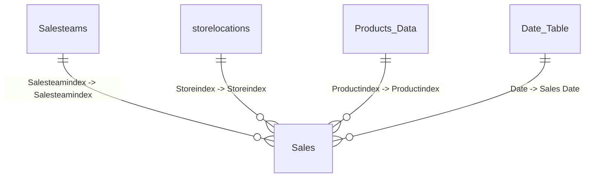

# Model relationships

Create these in **Model view** → **Manage relationships** (or drag columns between tables).

| From | Column | To | Column | Cardinality | Cross-filter |
|------|--------|-----|--------|-------------|-------------|
| Sales | Salesteamindex | Salesteams | Salesteamindex | M:1 | Single |
| Sales | Storeindex | storelocations | Storeindex | M:1 | Single |
| Sales | Productindex | Products_Data | Productindex | M:1 | Single |
| Sales | Sales Date | Date Table | Date | M:1 | Single |

